# Continuous Integration and Deployment Project Documentation

## Part 1 - Create a Docker container image

### Website Content

The website source files reside in the `web-content/` subdirectory of the repository. This directory contains the primary `index.html` file, secondary pages, and static assets.

* View the web content directory: [web-content/](https://github.com/Daniel00Blair/ceg3120-cicd-blair151-f26/tree/main/web-content)

### Dockerfile Explanation

The `Dockerfile` defines instructions to package the web content into an Apache web server container image (`httpd:2.4`).

* View the Dockerfile: [web-content/Dockerfile](https://github.com/Daniel00Blair/ceg3120-cicd-blair151-f26/blob/main/web-content/Dockerfile)

### Building an Image Locally

To build a container image directly from the repository Dockerfile locally, navigate to the project root and run:

```
docker build -t cicd-site:local ./web-content

```

### Tagging Requirements

When planning to push container images to Docker Hub, images must follow naming conventions (`username/repository:tag`). For semantic versioning, multiple tags (`latest`, major version, and major.minor version) map to the built image artifact.

### Running the Container Locally

To run the container and serve the web application locally on port 8080, execute:

```
docker run -d -p 8080:80 --name local-site cicd-site:local

```

Open a browser and navigate to `http://localhost:8080` to verify the application loads correctly. Stop and remove the test container using:

```
docker stop local-site && docker rm local-site

```

### Part 1 Testing and Proof: Local Run

This proves that the container builds and runs successfully, with `docker ps` confirming active container execution and the browser displaying the web pages with all CSS styling correctly applied.

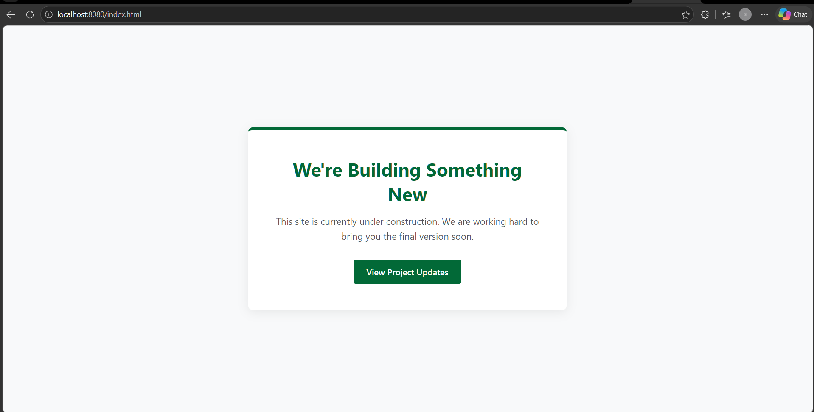


## Part 2 - GitHub Actions and DockerHub

### Configuring Repository Secrets

To allow GitHub Actions to securely authenticate and push container images to Docker Hub without hardcoding credentials, a Personal Access Token (PAT) with Read, Write, and Delete permissions is required.

1. Navigate to the repository on GitHub.

2. Click **Settings** > **Secrets and variables** > **Actions**.

3. Click **New repository secret**.

4. Add credentials with exact names: `DOCKER_USERNAME` and `DOCKER_TOKEN`.

### Secrets Set for This Project

* `DOCKER_USERNAME`: Stores the Docker Hub username.

* `DOCKER_TOKEN`: Stores the secure Docker Hub access token for authentication.

### Repository Secrets Proof

This proves that the repository secrets `DOCKER_USERNAME` and `DOCKER_TOKEN` are securely configured in GitHub Actions without displaying sensitive values.

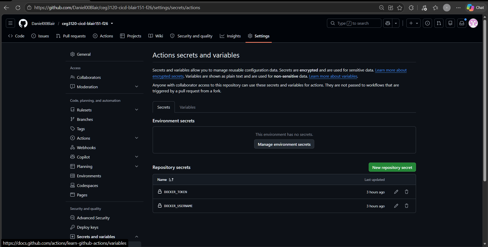

### Workflow Triggers & Steps

The CI pipeline workflow triggers automatically on pushes to the `main` branch and when semantic version tags (`v*.*.*`) are pushed.

#### Workflow Steps Breakdown:

1. **Checkout Code**: Checks out repository files using `actions/checkout@v4`.

2. **Log in to Docker Hub**: Authenticates with Docker Hub using `docker/login-action@v3` and repository secrets.

3. **Extract Metadata**: Generates appropriate image tags and labels using `docker/metadata-action@v5`.

4. **Build and Push**: Builds the Docker container from the `web-content` context and pushes the resulting image tags to Docker Hub using `docker/build-push-action@v5`.

### Repository & Workflow Changes

* **Workflow File Location**: `.github/workflows/docker-publish.yml`

* **Path Adjustments**: The `context` and `file` parameters in the workflow file were explicitly pointed to `./web-content` to accommodate the subdirectory structure.

### Part 2 Workflow Permalink

* View specific configuration via commit permalink: [Docker Publish Workflow Permalink](https://github.com/Daniel00Blair/ceg3120-cicd-blair151-f26/blob/main/.github/workflows/docker-publish.yml)

### Testing & Validating CI (Items 3 - 5)

* **Main Trigger Validation**: This proves that pushing a commit directly to `main` successfully spawns a workflow run with the commit SHA clearly visible.

  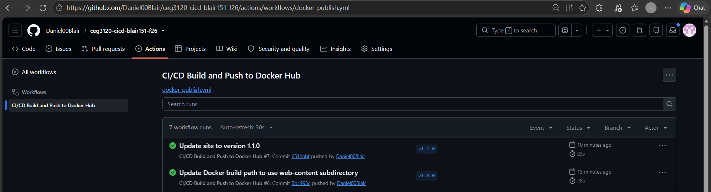

* **Branch Negative Test**: This proves that pushing a commit to a branch other than `main` (`feature/test-branch`) records the commit successfully while ensuring no automated workflow run is triggered.

  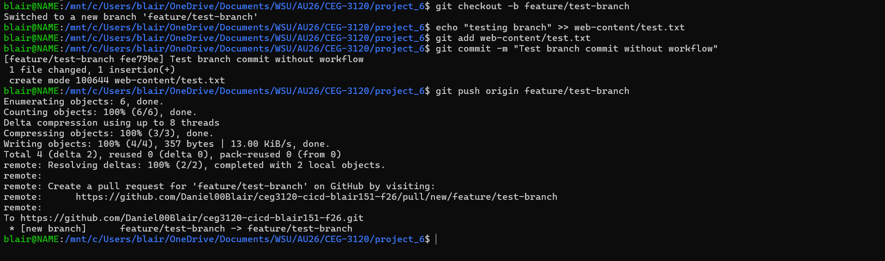
  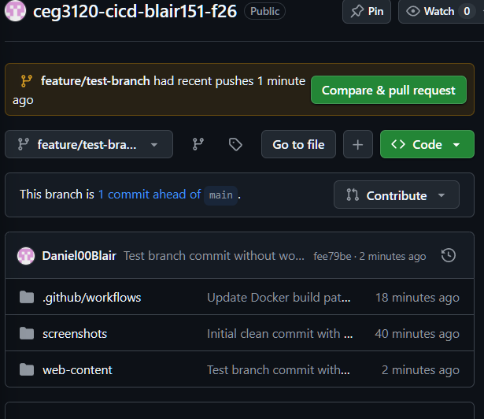
  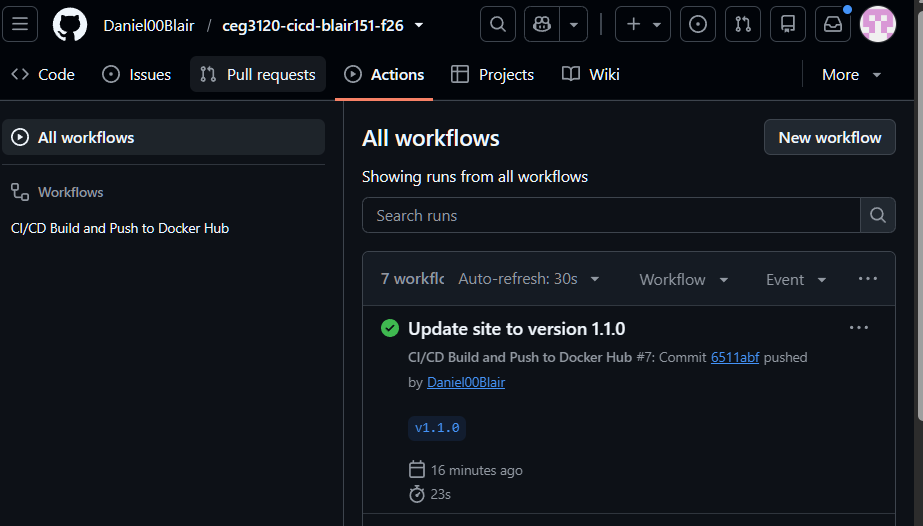

* **Image Change Verification**: This proves that updating visible site text, pushing to `main`, pulling `latest`, and running the container locally reflects the changes correctly in a browser.

  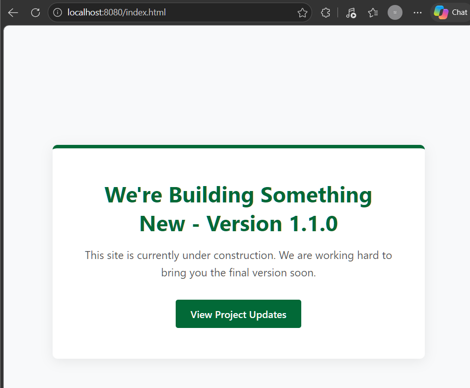

* **Docker Hub Repository Link**: [Docker Hub Repository - cicd-site](https://hub.docker.com/r/blairdan007/cicd-site)

## Part 3 - Semantic Versioning

### Git Tag Management

* **See existing tags**:

  ```
  git tag -l
  
  ```

* **Generate a new tag**:

  ```
  git tag v1.0.0
  
  ```

* **Push a tag to GitHub**:

  ```
  git push origin v1.0.0
  
  ```

### Semantic Versioning Container Images

When tags matching `v*.*.*` are pushed, the workflow dynamically generates tags for `latest`, major version (`1`), and major.minor version (`1.0`).

### Testing & Validating Tags (Items 6 - 10)

* **Tag Trigger Verification**: This proves that `git tag -l` lists local tags correctly and that pushing a tag successfully triggers a GitHub Actions workflow with the tag designated as its event.

  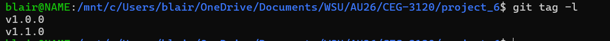
  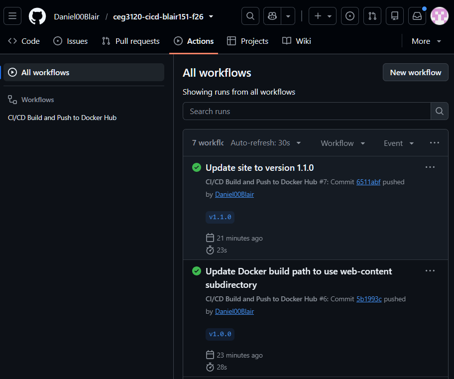

* **Tag Negative Test**: This proves that pushing a standard commit without a version tag registers on GitHub without triggering any tag-based workflow execution.

  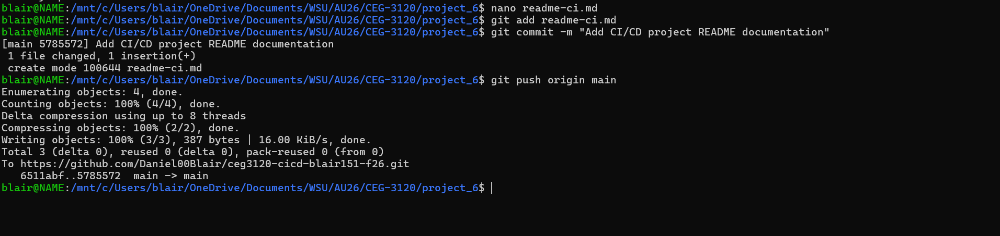
  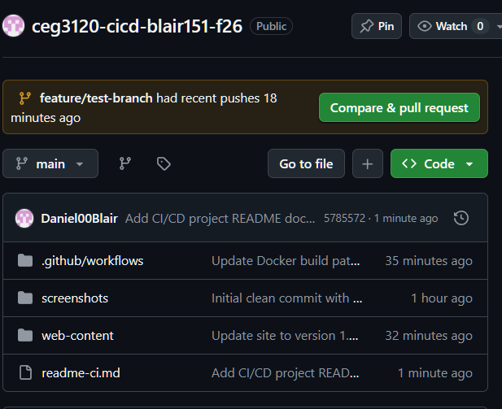
  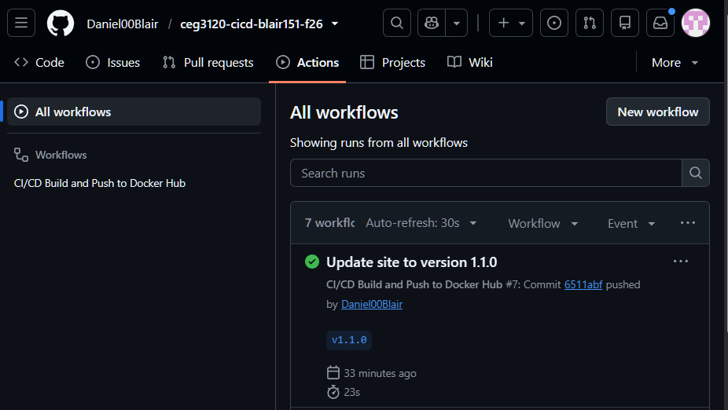

* **Tag Set on Docker Hub**: This proves that the Docker Hub repository successfully displays `latest`, major (`1`), and major.minor (`1.0`) tags.

  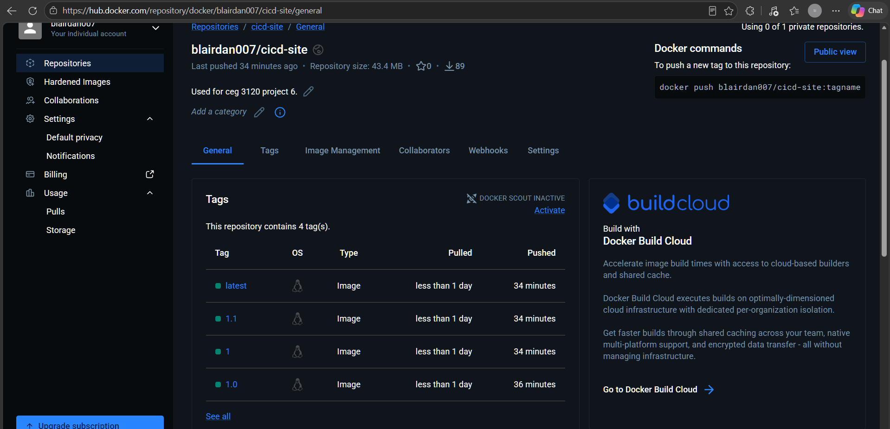

* **Two Releases & Digest Verification**: This proves that after completing two successive releases (`v1.0.0` and `v1.1.0`), the `1` and `latest` tags successfully migrated to the new image digest while `1.0` remained pinned to the older digest.

  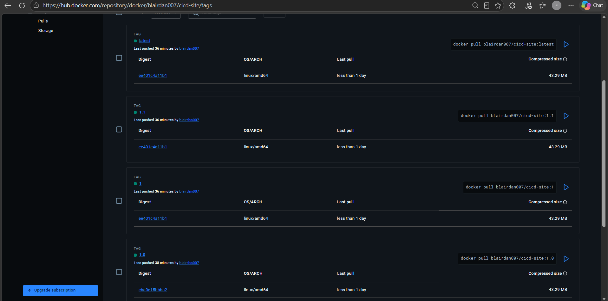

* **Rollback Verification**: This proves that running containers from distinct major.minor tags (`:1.0` and `:1.1`) concurrently allows each version to serve its respective versioned site output in the browser.

  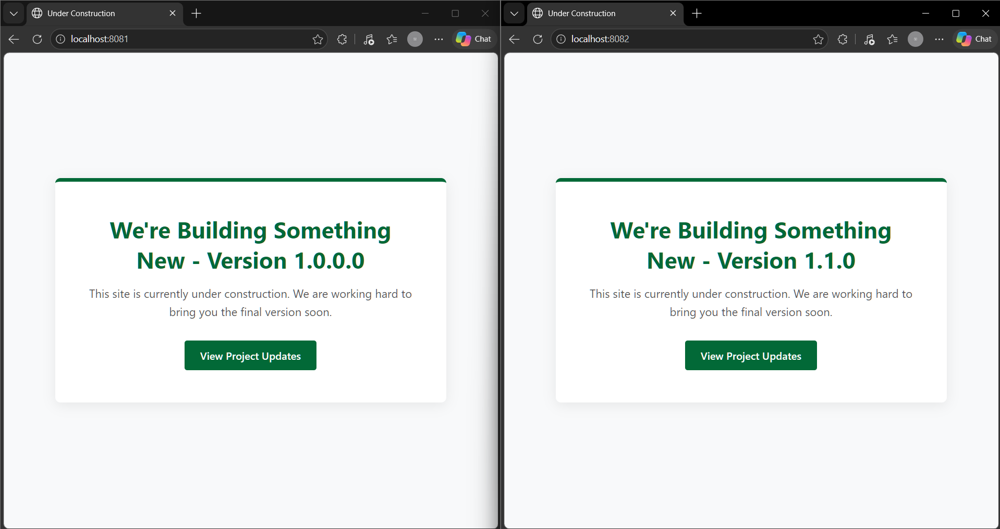
  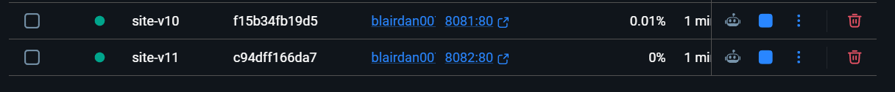

## Part 4 - Project Description & Diagram

### Project Overview

The goal of this project is to containerize a web application using Apache HTTP Server, automate the build and deployment pipeline using GitHub Actions for continuous integration, and implement semantic versioning through Git tags to manage container image releases on Docker Hub.

### Website Generation Statement

The website content (`index.html`) (`webpage_2.html`) was designed and generated with the assistance of Generative AI (Google Gemini).

### Architectural Diagram

```
graph LR
    A[Developer / WSL2] -->|Git Push Commit/Tag| B(GitHub Repository)
    B -->|Trigger Workflow| C(GitHub Actions CI/CD)
    C -->|Authenticate with Secrets| D[Docker Hub Registry]
    C -->|Build & Push Image Tags| D
    D -->|Pull & Run Container| E[Local Browser Verification]

```

### Known Issues

All core objectives—including containerization, automated GitHub Actions CI/CD pipelines, secret management, semantic versioning tag triggers, and multi-version rollbacks—are fully functional. There are no known broken features in this implementation.

### Resources & Citations

1. **Docker Documentation**: Used for writing `Dockerfile` syntax and understanding build contexts.

   * Link: <https://docs.docker.com/>

2. **GitHub Actions Documentation**: Used for structuring workflow YAML files and integrating official Docker action plugins.

   * Link: <https://docs.github.com/en/actions>

3. **Generative AI (Google Gemini)**: Used as a collaborative writing and debugging coach throughout the development of container configuration files, git troubleshooting, correcting errors in .yml formatting, and README structuring.

   * **Prompts Used**:

     * *"generate me the most simple, barebones test website with two .html files and a styles.css file for a Docker container"*

     * *"how do i push that file to github"*

     * *"error: cannot pull with rebase: You have unstaged changes"*

     * *"why is my git commits from my local computer not showing up on github"*

     * *"help me structure the markdown content and sections for this readme file"*

     * *"double check the formatting of this .yml file for errors"*

     * *"how do i fix push rejected errors when remote has changes"*

     * *"show me how to delete and re-create a git tag locally and remotely"*

   * **Statement of Use**: Gemini was utilized to troubleshoot WSL2 Git command-line errors, clarify CI/CD workflow syntax requirements for subdirectory Dockerfiles, generate a simple test website for project 5 that was then used in project 6 correct errors in .yml file, and format the readme-ci.md.
